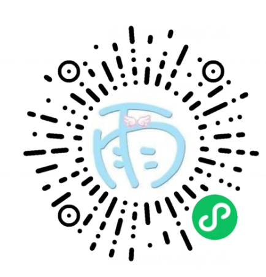

# 心动分析

用聊天记录，读懂关系里的心动信号。

## 它做什么

- 粘贴聊天文本，或上传最多 9 张聊天截图（自动 OCR，同一张截图会复用已识别的结果）。
- 生成 0–100 的心动指数，并按《稳稳俘获意中人：如何让你爱的人爱上你》的吸引力框架拆成五维：初见吸引、相似共鸣、互补吸引、自尊滋养、投入推进。
- 每条信号标注对应的维度，并给出带原文引用的解读。
- 从书中的心动原理里挑选 2–3 条解释这段聊天，再给出下一步行动建议和 3 条可直接复制的回复话术。
- 支持继续追问、保存结果海报、本地历史记录。

结果只保存在本机微信 Storage 中，最多 20 条，可随时删除；不保存截图和完整聊天原文（截图识别出的文字会短期缓存，便于同一张图复用）。

框架只用于理解真实信号和改善真诚沟通，不提供操控、假装、试探、跟踪、骚扰或 PUA 话术；性技巧与性别刻板印象不在分析范围内。

## 本地运行

1. 用微信开发者工具打开项目根目录。
2. 复制 `config/secrets.example.js` 为 `config/secrets.local.js`，填入自己的 DeepSeek 与 OCR.space Key。
3. 在开发者工具中勾选「不校验合法域名、web-view（业务域名）、TLS 版本以及 HTTPS 证书」（仅为本地调试）。
4. 运行测试：`npm test`。

`config/secrets.local.js` 已被 `.gitignore` 忽略，请勿提交。密钥会随小程序包一起下发，只适合自用/演示；正式上线必须改为云函数或服务端中转。若某个密钥曾经进入公开仓库的历史记录，请立即在服务商后台作废并重新生成。

## 微信小程序码

## 已知限制

- `ocr.space` 是境外域名、无 ICP 备案，无法加入小程序 `uploadFile` 合法域名，**真机/体验版的截图识别会失败**，目前仅开发者工具可用。
- 无后端，无法调用微信内容安全接口；当前用本地敏感词与模型安全字段兜底。
- 正式上线前还需要：隐私保护指引、`wx.requirePrivacyAuthorize`、内容安全检测、`api.deepseek.com` 合法域名、审核类目确认。
